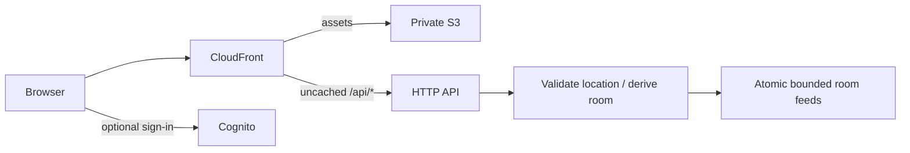

# Architecture and technical specification

## Product rules

**Read anywhere. Post from where you are.** Viewing and posting locations are separate. Any visitor may browse a valid geohash room (prefix length 1–8). Every new post is assigned by the server to the location reported by the browser, independently of the viewed URL. Guests remain supported; an account is not required.

Each room maintains its own independent **newest 1,000 posts**:

`Room(p) = Newest_1000 { m : m.room starts with p }`

A post contributes to its origin and all ancestors, never descendants. Evicting a copy from one room does not evict copies in other rooms. There is **no time-based expiration** of posts or feeds. Quiet rooms retain their remaining posts indefinitely. Ordering is server creation timestamp followed by UUID (a deterministic tie-breaker). Moderation replaces text with a tombstone; tombstones occupy a feed slot until normal count eviction. No older post is backfilled after moderation.

These rules supersede the original arbitrary-room posting and indefinite full-history retention design.

## Posting location and privacy

On Send, the browser requests `getCurrentPosition` with `maximumAge: 0`, `enableHighAccuracy: true`, and a 15-second timeout. Permission failure preserves the draft and leaves browsing available. The request contains text, a stable retry UUID, latitude, longitude, reported accuracy radius in meters and a timestamp in epoch milliseconds. The destination is `POST /api/messages`; the old room-addressed posting route is removed. Client-supplied `room` or `geohash` fields are ignored.

The server validates finite coordinate ranges, positive accuracy no worse than **5,000 meters**, age no greater than **60 seconds**, and future skew no greater than **5 seconds**. These are explicit initial policy choices, centralized in shared validation. It independently encodes the location and selects the finest precision, up to 8, whose cell width and height are each at least twice the reported accuracy radius. Width is adjusted for latitude using a spherical Earth approximation. If no allowed cell is suitable (for example, very near a pole), the fix is rejected. A 25-meter radius typically selects a coarser cell than precision 8.

This selects an appropriate spatial resolution; it does not guarantee that the uncertainty circle lies within the chosen cell, especially at boundaries. Location, accuracy and timestamp are all untrusted client claims. This deters accidental remote posting and arbitrary destination parameters, **not location spoofing**. Browser geolocation offers no guarantee of the actual physical location. See the [W3C Geolocation specification](https://www.w3.org/TR/geolocation/). IP geolocation checks and native device attestation are not implemented.

Only the derived geohash is stored with messages. Raw coordinates, accuracy and location timestamp are not stored in messages, receipts, sessions, feeds, activity or logs. Coordinates exist transiently in the request and application memory. Do not enable request-body logging upstream. A geohash can itself reveal a sensitive location; this is explained in the posting/help UI. Reports contain user-provided reasons, which may independently contain sensitive information.

After a successful post, the UI shows the authoritative posting room and a link to it. It inserts the post into the viewed feed only when that feed is an ancestor of the actual posting room. Browsing elsewhere does not redirect the post or force navigation. Retries keep their request ID even if the viewer changes rooms; every send attempt obtains a fresh fix. A retry returns the originally accepted post rather than moving it.

## Browsing, identity and delivery

Smart zoom still picks the deepest ancestor with at least three posts in the current and previous three five-minute activity buckets (15–20 minutes). Quiet areas fall back to precision 5 or the supplied shorter prefix. This controls browsing only, not posting precision. Location permission is optional for browsing and required for posting.

Guest tokens are cryptographically random, stored only as SHA-256 hashes on the server, and checked for their 30-day expiration independently of DynamoDB TTL cleanup. Cognito ID tokens are verified for signature, issuer, audience, token use and expiration. Only the `moderators` group grants moderation access. Display names are not unique. The frontend polls every five seconds while visible; history browsing pauses polling.

## DynamoDB schema v2

One encrypted on-demand table with `pk`/`sk`, point-in-time recovery and retain-on-removal. No scans or secondary indexes on request paths.

| PK                               | SK                           | Attributes                                                | Expiration                         |
| -------------------------------- | ---------------------------- | --------------------------------------------------------- | ---------------------------------- |
| `ROOM#<prefix>`                  | `FEED`                       | `keys` (up to 1,000 sorted message sort keys), `revision` | None                               |
| `ROOM#<prefix>`                  | `MSG#<ISO>#<UUID>`           | Message projection                                        | Count eviction only                |
| `MESSAGE#<UUID>`                 | `META`                       | `message`, `retainedRooms`, `revision`                    | Deleted when final copy is evicted |
| `REQUEST#<actor>#<request UUID>` | `META`                       | `messageId` only                                          | TTL after 24 hours                 |
| `SESSION#<token hash>`           | `META`                       | `identity`, `expiresAt`                                   | TTL after 30 days                  |
| `USER#<actor>`                   | `META`                       | `banned`                                                  | None                               |
| `RATE#<scope>#<minute>`          | `META`                       | `count`, `expiresAt`                                      | TTL after 2 minutes                |
| `ACTIVITY#<prefix>`              | `BUCKET#<five-minute index>` | `count`, `expiresAt`                                      | TTL after bucket end + 20 minutes  |
| `REPORTS`                        | `REPORT#<ISO>#<UUID>`        | Report reason and references                              | None                               |

TTL is used for ephemeral control records, **never message retention**. Reports retain references/reasons even if their subject has been evicted; moderation must tolerate a 404. PITR may retain earlier content according to backup policy.

## Atomic retention and concurrency

For each new post, read up to eight feed metadata records and compute the newest 1,000 keys after insertion. For each evicted key, read its canonical record and remove only the affected rooms from its membership. All feed replacements use optimistic revision conditions. Victim canonical changes use their own revision conditions to coordinate concurrent evictions and moderation.

One transaction checks the ban, enforces rate limits, records the request receipt, writes the canonical record and surviving new projections, updates activity and feed metadata, deletes evicted projections, and updates/removes their canonical records. There is no eventually consistent trimming window. At maximum precision the transaction uses at most **45 distinct item operations** (29 baseline plus at most eight projection deletes and eight victim canonical changes). A feed metadata item is about 70 KB of sort keys, comfortably below the item limit; aggregate transaction payload stays below 4 MB with current text/key limits. AWS documents [transaction limits and conditional atomicity](https://docs.aws.amazon.com/amazondynamodb/latest/developerguide/transaction-apis.html).

Concurrent modifications fail the conditions, roll back every write, and retry with fresh state up to four attempts. Exhaustion returns 429 and the client retains its request ID. Rate limits are ten posts per identity/minute, thirty per source-IP hash/minute, five guest sessions per source-IP hash/minute, and five reports per identity/minute. Only committed transactions consume the posting counters. Fixed windows can burst across minute boundaries.

Deletion loads current canonical membership and updates only retained copies, conditioned on canonical revision and projection existence. This prevents deletion from recreating a previously evicted parent copy. Content is removed from canonical and retained projections atomically. Receipts contain no message body. If a retry references a post already evicted everywhere, return 410 instead of recreating it. A very delayed new write can already fall outside all full feeds; it is accepted and immediately evicted under the same newest-key ordering. Deduplication lasts at least 24 hours; clients must not retry old posts beyond that horizon.

Reads query a single room, newest first, 50 records per page, strongly consistent. Cursors validate partition/sort keys and are not signed secrets. Pagination is not a frozen snapshot: concurrent eviction can remove entries between pages. Inactive feeds retain their posts indefinitely. Activity includes accepted posts even if later removed; it is an approximate signal, not the retained feed count.

## Deployment compatibility and scale

The CDK table resource is now `DataV2`, so an existing v1 deployment gets a **new empty table**; the old table is retained, not destroyed or silently reused. The earlier implementation was not deployed in this session. See the deployment guide before updating an external v1 deployment. Populating v2 requires reconstructing each feed's newest 1,000 keys and canonical memberships under a write freeze; copying old items unchanged is invalid.

This prioritizes exact bounded feeds and straightforward verification over high write throughput. Updating roughly 70 KB of metadata per active ancestor consumes significantly more write capacity than a simple append. Coarse-prefix metadata and canonical records can contend. Load-test latency, throttling, cost and contention before public launch. A future design can use a serialized per-room writer and a different bounded index while preserving the same invariant; asynchronous trimming would weaken it.

CloudFront uses a single browser origin and proxies uncached API traffic. API Gateway source IP behind CloudFront may identify an edge rather than the viewer; source-IP limits are only a conservative shared backstop. Guest identities can be recreated. WAF/viewer-IP controls, traffic testing, moderation operations and alert routing remain launch work. The in-memory store models feed behavior but is not a durability or concurrency emulator; DynamoDB transaction tests use a conditional-write test double, not a live AWS database.
